# Portfolio SIG – Mahamat Adam Ibrahim

Cartes thématiques du Tchad réalisées sous **QGIS** à partir de données ouvertes : réfugiés et déplacés, accès aux services, sécurité alimentaire, santé, feux, végétation, hydrographie et plan urbain.

*GIS portfolio: thematic maps of Chad made in QGIS from open data (refugees and IDPs, access to services, food security, health, wildfires, vegetation, hydrology, urban mapping). Text in French; contact me in English, French or Arabic.*

📄 [Télécharger le portfolio complet (PDF)](Portfolio_SIG_Mahamat_Adam_Ibrahim.pdf)

## Analyses

**Réfugiés au Ouaddaï** ([carte](maps/01_ouaddai_refugies.jpg)) : 28 sites dans la zone, dont 11 dans la province, alignés le long des routes d'Adré, de Farchana et de Gaga, à quelques dizaines de kilomètres des camps de déplacés du Soudan (Durti, Abu Zer).

**Accès à la santé au Ouaddaï** ([carte](maps/02_ouaddai_acces_sante.jpg)) : 67 % du territoire est à plus de 2 h de marche d'une formation sanitaire fonctionnelle (86 recensées en 2020) et 24 % à plus de 4 h, surtout au sud de Djourf Al Ahmar. Ce sont des pourcentages de surface, pas de population.

**Sécurité alimentaire au Batha** ([carte](maps/13_batha_cadre_harmonise.jpg)) : Le Fitri passe de la phase minimale (2014-2019) à « sous pression » (2020-2026) ; la phase moyenne de la province passe de 1,7 à 1,9.

**Paludisme au Chari-Baguirmi** ([carte](maps/14_chari_baguirmi_paludisme.jpg)) : Prévalence moyenne stable à 15,9 %, mais la carte s'uniformise : les zones à plus de 25 % passent de 3,3 % à 0,1 % de la province et les zones à moins de 10 % de 14,4 % à 0,3 %. Série arrêtée en 2022.

**Végétation au Kanem** ([carte](maps/15_kanem_vegetation.jpg)) : NDVI moyen de 0,17 à 0,19 et végétation forte de 6,6 % à 10 % de la province. Les années 2017-2024 ont été plus pluvieuses : le verdissement suit d'abord la pluie.

**Feux au Salamat** ([carte](maps/11_salamat_feux.jpg)) : 40 992 détections en 2024, concentrées au sud (Haraze Mangueigne) et au centre-nord ; 95 % d'octobre à février, pic en décembre.

**Déplacés au Lac** ([carte](maps/10_lac_deplaces.jpg)) : 292 sites actifs : 219 sites de déplacés internes, 72 villages hôtes ou de retour, 1 camp de réfugiés ; concentration à Fouli et le long de l'axe Bol-Kaya.

## Les cartes

| Aperçu | Carte | Méthode | Données |
|---|---|---|---|
| [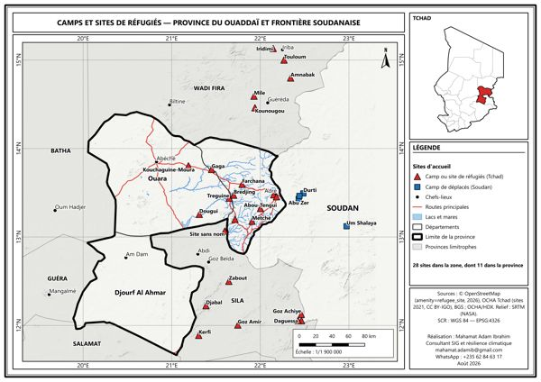](maps/01_ouaddai_refugies.jpg) | Camps et sites de réfugiés – Ouaddaï et frontière soudanaise | Fusion OSM + OCHA, doublons à moins de 3 km retirés | OpenStreetMap, OCHA |
| [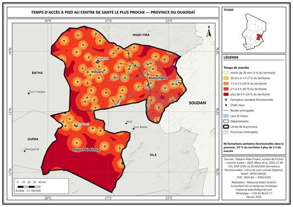](maps/02_ouaddai_acces_sante.jpg) | Temps d'accès à pied au centre de santé le plus proche – Ouaddaï | Coût cumulé (Dijkstra) sur une surface de friction « marche à pied » | Malaria Atlas Project, MSP 2020 via OCHA/HDX |
| [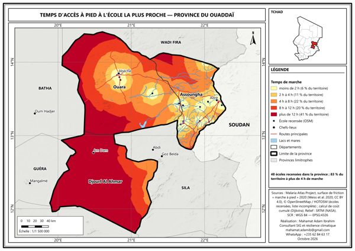](maps/03_ouaddai_acces_ecoles.jpg) | Temps d'accès à pied à l'école – Ouaddaï | Coût cumulé sur surface de friction | Malaria Atlas Project, OpenStreetMap |
| [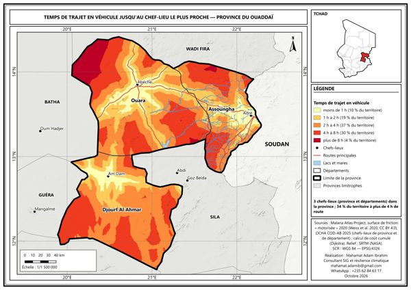](maps/04_ouaddai_acces_chefs_lieux.jpg) | Trajet en véhicule jusqu'au chef-lieu – Ouaddaï | Coût cumulé sur surface de friction motorisée | Malaria Atlas Project, OCHA COD-AB |
| [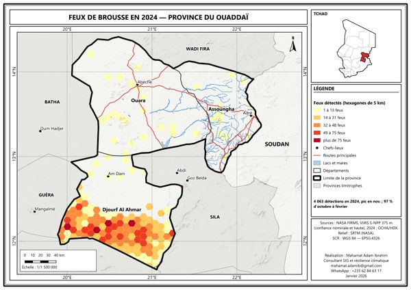](maps/05_ouaddai_feux.jpg) | Feux de brousse 2024 – Ouaddaï | Détections comptées dans une grille hexagonale de 5 km | NASA FIRMS (VIIRS) |
| [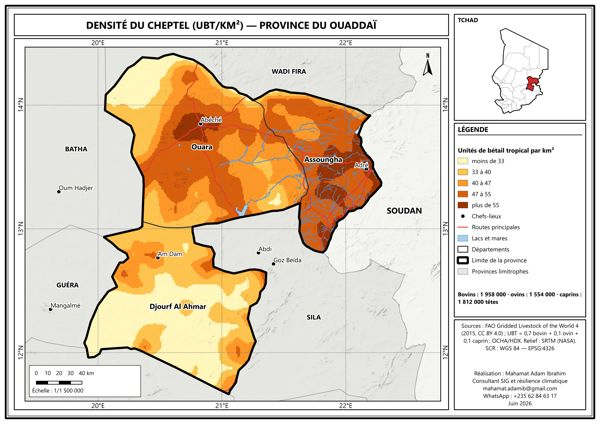](maps/06_ouaddai_cheptel.jpg) | Densité du cheptel – Ouaddaï | Conversion en UBT par km² | FAO GLW4 |
| [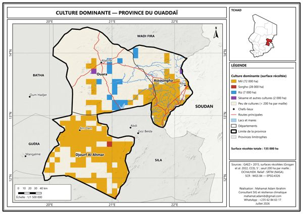](maps/07_ouaddai_cultures.jpg) | Culture dominante – Ouaddaï | Culture la plus étendue par maille | GAEZ+ 2015 |
| [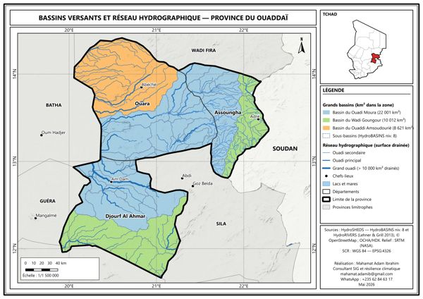](maps/08_ouaddai_bassins.jpg) | Bassins versants – Ouaddaï | Regroupement Pfafstetter, réseau par surface drainée | HydroSHEDS |
| [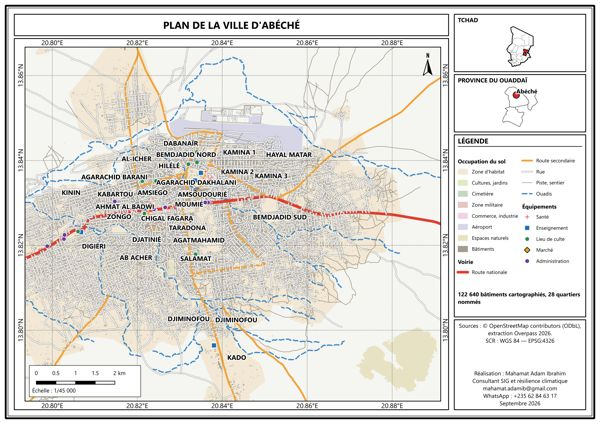](maps/09_abeche_plan.jpg) | Plan de la ville d'Abéché | Voirie hiérarchisée, bâti, occupation du sol, équipements | OpenStreetMap |
| [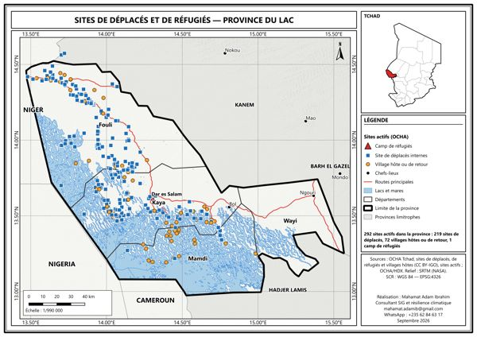](maps/10_lac_deplaces.jpg) | Sites de déplacés et de réfugiés – Lac | Sites actifs, par type | OCHA |
| [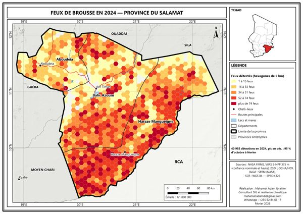](maps/11_salamat_feux.jpg) | Feux de brousse 2024 – Salamat | Détections comptées dans une grille hexagonale de 5 km | NASA FIRMS (VIIRS) |
| [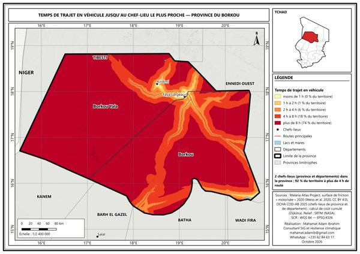](maps/12_borkou_acces_chef_lieu.jpg) | Accès au chef-lieu – Borkou | Coût cumulé sur surface de friction motorisée | Malaria Atlas Project, OCHA COD-AB |
| [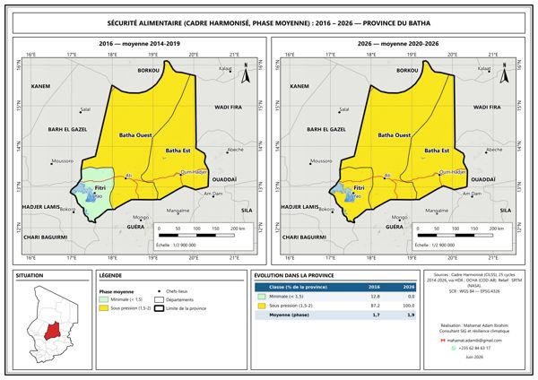](maps/13_batha_cadre_harmonise.jpg) | Sécurité alimentaire (Cadre Harmonisé) 2016-2026 – Batha | Phase moyenne sur 25 cycles, 2014-2019 comparé à 2020-2026 | Cadre Harmonisé (CILSS) via HDX |
| [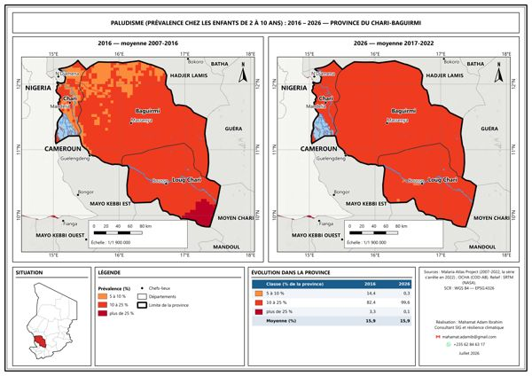](maps/14_chari_baguirmi_paludisme.jpg) | Paludisme chez les 2-10 ans 2016-2026 – Chari-Baguirmi | Prévalence moyenne 2007-2016 comparée à 2017-2022 | Malaria Atlas Project |
| [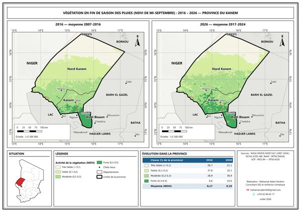](maps/15_kanem_vegetation.jpg) | Végétation de fin de saison (NDVI) 2016-2026 – Kanem | NDVI de mi-septembre, 2007-2016 comparé à 2017-2024 | NASA MODIS MOD13A1 |
| [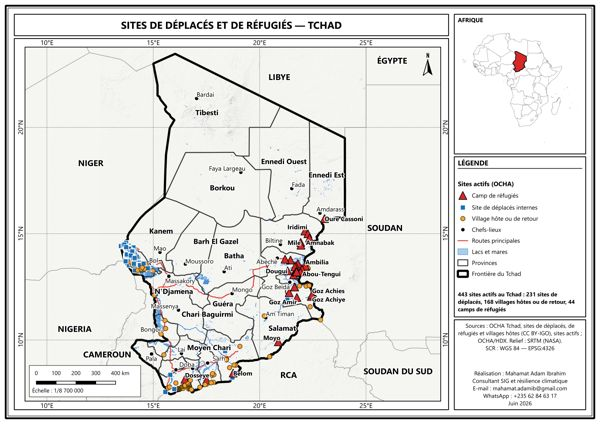](maps/16_tchad_refugies.jpg) | Camps de réfugiés – Tchad | Fusion OSM + OCHA | OpenStreetMap, OCHA |

## Méthode de travail

Mise en page A4 ou A3 paysage, carte de situation, légende, échelle, sources et auteur sur chaque planche. Les analyses temporelles comparent deux périodes (« 2016 » = moyenne 2007-2016, « 2026 » = moyenne 2017-2026 jusqu'à la dernière année disponible) avec les mêmes classes et couleurs. Les rasters sont découpés sur la zone d'étude et les sources de données sont citées sur chaque carte.

Outils : QGIS 3.44, Python (PyQGIS, rasterio, GDAL), Google Earth Engine, KoboToolbox, Excel, R.

## Contact

Mahamat Adam Ibrahim, géographe (MEAL et SIG), Abéché, Tchad  
✉️ mahamat.adamib@gmail.com · [LinkedIn](https://www.linkedin.com/in/mahamat-adam-ibrahim)

© Mahamat Adam Ibrahim. Cartes partagées pour consultation ; merci de citer l'auteur et les sources de données en cas de réutilisation.
